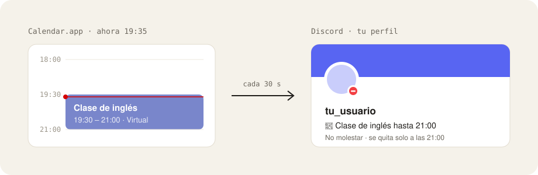

# discord-calendar-status

**Tu estado de Discord, sincronizado con tu calendario, como en Slack.** Mientras tienes un evento en curso pone No molestar y «📅 Título hasta HH:MM». Cuando termina, deja todo como estaba.

   



Slack lo hace solo con Google Calendar; Discord no. Esto lee los calendarios que ya tienes en Calendar.app (Google, iCloud, Exchange, lo que sea) y cambia tu estado desde Vesktop. Como el estado es de la cuenta, se ve igual en Discord para escritorio y en el celular.

## Qué hace

- Pone **No molestar** y «📅 Clase de inglés hasta 21:00» durante el evento, y el estado personalizado se borra solo al terminar, aunque cierres Vesktop.
- Al terminar restaura tu estado anterior, salvo que lo hayas cambiado a mano durante el bloque.
- Te deja personalizar cada evento o serie desde los ajustes del plugin: emoji, texto, tipo de conexión y horas.
- Si estás en Invisible, no toca nada.

## Cómo funciona

1. `calendar/main.swift` lee Calendar.app por EventKit y escribe los eventos con hora de los próximos 7 días en `~/Library/Application Support/discord-calendar-status/state.json`. Lo ejecuta launchd cada 60 s (`com.diego.discord-calendar-status`).
2. `plugin/calendarStatus/` es un userplugin de Vencord que lee ese archivo cada 30 s, decide qué evento está en curso y cambia el estado desde dentro de Vesktop.

Vesktop tiene que estar abierto (basta con que esté en la bandeja).

## Instalar / actualizar

Necesitas macOS 14 o superior, [Vesktop](https://github.com/Vencord/Vesktop), las Xcode Command Line Tools (`swiftc`) y Node.

```sh
git clone https://github.com/Chere3/discord-calendar-status.git
cd discord-calendar-status
./install.sh
```

`install.sh` compila el lector en `~/.local/bin/discord-calendar-state`, registra el LaunchAgent y construye Vencord (clonado en `vendor/Vencord`) con el plugin. La primera vez macOS te pide permiso para leer Calendarios. Tras cambiar el plugin, vuelve a ejecutarlo y reinicia Vesktop.

Configuración que se hace una sola vez en `~/Library/Application Support/vesktop/`:

- `state.json` → `vencordDir` apunta a `vendor/Vencord/dist`.
- `settings/settings.json` → plugin `CalendarStatus` activado y `autoUpdate` desactivado. Este Vencord se actualiza con `install.sh`, no con su actualizador.

## Elegir calendarios

Por defecto se leen todos los calendarios de Calendar.app. Para limitarlos, crea `~/Library/Application Support/discord-calendar-status/config.json` con los títulos tal como aparecen en Calendar.app (hay un ejemplo en `config.example.json`):

```json
{ "calendarios": ["tu-correo@gmail.com", "Trabajo", "Escuela"] }
```

El lector vuelve a leerlo cada minuto, así que no hay que recompilar ni reiniciar nada.

## Personalizar eventos

Vesktop → Ajustes → Plugins → **CalendarStatus** → engrane. Muestra la agenda de 7 días con la vista previa del estado de cada evento:

- El interruptor activa o desactiva el evento. En los recurrentes (↻) actúa sobre toda la serie.
- Al pulsar un evento se abre el editor: emoji, texto (`{titulo}` y `{hasta}` se sustituyen), tipo de conexión y horas Desde/Hasta (HH:MM sobre el día del evento).
- En recurrentes se elige el alcance: **Toda la serie** o **Sólo esta vez**. Lo puntual gana a la serie.
- Los cambios se aplican al momento y se guardan en los ajustes de Vencord (`overrides`). La clave usa la cuenta y el UID del evento, así que sobrevive si mueves el evento a otro calendario de la misma cuenta.

## Reglas

- Por defecto cuenta cualquier evento con hora: No molestar y «📅 Título hasta HH:MM». Se ignoran los de todo el día y los rechazados.
- Si hay varios eventos activos a la vez, manda el que termina más tarde.
- El estado personalizado lleva caducidad al fin del evento, así que Discord lo borra aunque Vesktop se cierre. El tipo de conexión no caduca solo.
- Al terminar un bloque el plugin vigila 3 minutos que el tipo de conexión siga restaurado, y lo reaplica si otro cliente lo revierte.
- Sólo emojis Unicode; los personalizados de servidor no están soportados.

## Diagnóstico

Registro: `~/Library/Logs/discord-calendar-status.log`. El plugin anota ahí (líneas `[plugin]`) cada bloque que pone, cada restauración, los errores y si el ciclo se retrasa. El lector escribe sus errores en el mismo archivo.

## Desinstalar

```sh
launchctl bootout gui/$UID/com.diego.discord-calendar-status
rm ~/Library/LaunchAgents/com.diego.discord-calendar-status.plist ~/.local/bin/discord-calendar-state
```

Luego quita `vencordDir` de `state.json` de Vesktop. Hay respaldos `.bak` junto a ambos archivos.

## Proyecto hermano

[calendario-por-colores](https://github.com/Chere3/calendario-por-colores) es una skill de Claude Code que organiza Google Calendar en un calendario por categoría. Este plugin lee esos calendarios.

## Aviso

Proyecto personal, no afiliado a Discord ni a Vencord. Los mods de cliente van contra los términos de servicio de Discord: úsalo bajo tu propio riesgo.

## Licencia

[GPL-3.0](LICENSE), igual que Vencord.
